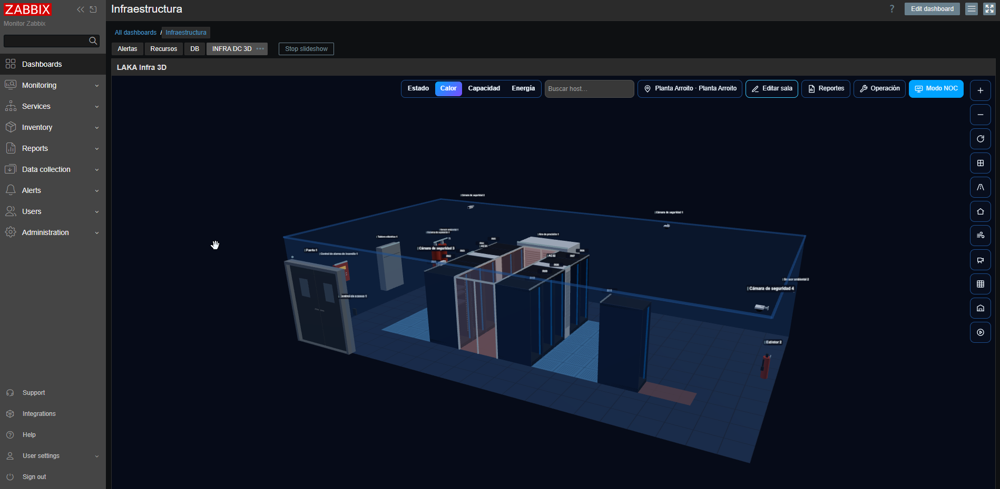
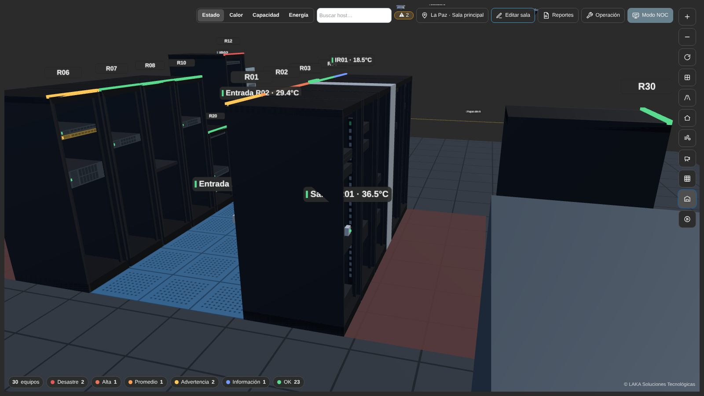
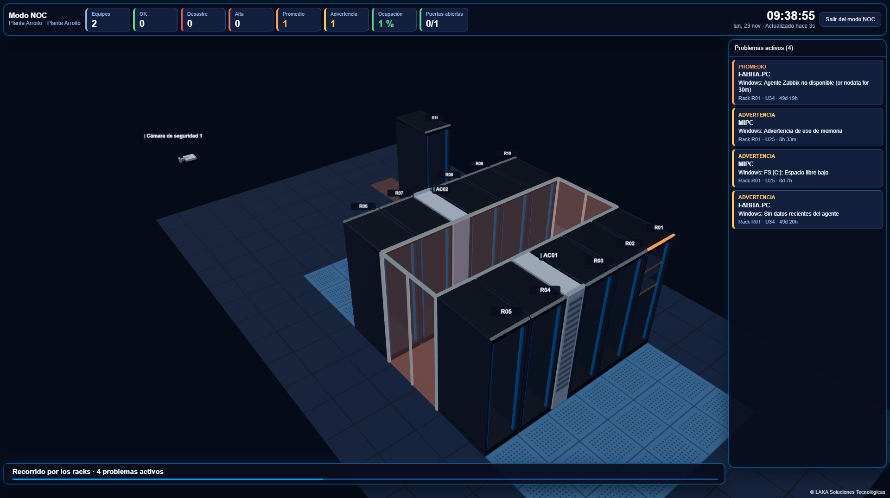

# LAKA Infra 3D - Beta

**Gemelo digital 3D de data center para Zabbix 7.0 – 8.0**

   

> ⚠️ **Versión beta.** El módulo es funcional y se probó en Zabbix 7.0, 7.4 y 8.0 con MySQL/MariaDB y PostgreSQL. Sin embargo, todavía puede tener errores y cambios entre versiones. Pruébalo primero en un entorno de laboratorio y haz un respaldo antes de usarlo en producción.

LAKA Infra 3D es un widget para tableros de Zabbix. Muestra la sala del data center en 3D, con sus filas, racks, equipos e infraestructura. Cada elemento toma su estado en vivo desde Zabbix. Está pensado para NOC y para la operación diaria de la sala.

---

## Alcance

**Qué incluye**

- **Sala en 3D** con racks y equipos en su U. Cada equipo se colorea según la severidad de su problema más grave y usa los colores del frontend de Zabbix.
- **Modos de vista:** Estado, Calor (mapa de calor del piso), Capacidad y Energía.
- **Infraestructura:** aires, UPS, tableros, sensores, puertas, CDU y medidores, vinculados a hosts de Zabbix.
- **Modo NOC:** recorrido automático por la sala y por los racks con problemas.
- **Sala abierta:** oculta las paredes para recorrer la sala rack por rack.
- **Editor de sala** para administradores: racks, equipos, infraestructura y cableado. Se pueden importar y exportar salas en CSV o JSON.
- **Energía y eficiencia:** PUE y los indicadores ISO/IEC 30134 (REF, ERF, WUE, CUE), reporte anual y pronóstico de capacidad.
- **Operación:** órdenes de trabajo que crean el mantenimiento en Zabbix, ciclo de vida desde el inventario y etiquetas QR.
- **Gestión:** varios sitios y salas con mapa, historial con opción de deshacer, permisos por sala y respaldo completo.
- **Interacción con el tablero:** envía el host elegido a los otros widgets y también recibe hosts de ellos.
- **Idiomas:** español, portugués (Brasil) e inglés.

**Qué no incluye**

- No reemplaza a un DCIM comercial ni hace gestión de activos financieros.
- La autoevaluación de redundancia (TIA-942) es **orientativa**, no una certificación.
- No recolecta datos por su cuenta: todo lo que muestra viene de los hosts, ítems y problemas que ya tienes en Zabbix.

## Capturas

**Modo Calor**: mapa de calor del piso y temperatura de entrada de cada rack según ASHRAE.

**Sala abierta**: sin paredes, para recorrer la sala rack por rack.

**Modo NOC**: recorrido automático con indicadores y problemas activos.

> Las capturas usan datos de prueba.

## Requisitos

- Zabbix **7.0, 7.2, 7.4 u 8.0**.
- Base de datos **MySQL / MariaDB o PostgreSQL**, con o sin TimescaleDB.
- PHP con la extensión `zlib`, que viene incluida en casi todas las distribuciones.
- Un navegador con WebGL: Chrome, Edge o Firefox recientes.

## Instalación

1. Copia la carpeta `laka_infra_3d` en la carpeta `modules/` del frontend de Zabbix. Por ejemplo:
   - `/usr/share/zabbix/modules/`
   - o `/usr/share/zabbix/ui/modules/`, según la instalación.
2. En Zabbix, ve a **Administración › General › Módulos** y pulsa **Escanear directorio**.
3. Habilita **LAKA Infra 3D**.
4. En un tablero, agrega el widget **LAKA Infra 3D**.

## Inicio rápido

Hay dos formas de ubicar los equipos:

- **Con tags en cada host:** `rack` (por ejemplo `R03`) y `u` (por ejemplo `18`). Si quieres, agrega también `alto`, `fila`, `tipo` y `sala`.
- **Con el editor:** usa **Editar sala** y elige una plantilla (cuarto de comunicaciones, sala pequeña, sala mediana o data center).

La ubicación que guardas en el editor tiene prioridad sobre los tags.

## Problemas y sugerencias

Si encuentras un error puedes reportarlo para corregir

## Licencia

[GPLv3](LICENSE) · © LAKA Soluciones Tecnológicas · Autor: Willian Tola 

---

### English

**LAKA Infra 3D** is a **beta** 3D data-center digital twin widget for Zabbix 7.0–8.0. It shows rooms, racks, devices and facility equipment with live Zabbix status. It also includes NOC mode, a room editor, energy KPIs (PUE, ISO/IEC 30134), work orders linked to Zabbix maintenance, and QR labels. It supports MySQL/MariaDB and PostgreSQL, and is available in Spanish, Portuguese (Brazil) and English. Test it in a lab first.

To install, copy `laka_infra_3d` to the frontend `modules/` folder. Then go to Administration › General › Modules, scan the directory and enable the module.

### Português (Brasil)

**LAKA Infra 3D** é um widget 3D de gêmeo digital de data center para Zabbix 7.0–8.0, em versão **beta**. Mostra salas, racks, equipamentos e infraestrutura com o status ao vivo do Zabbix. Também inclui modo NOC, editor de sala, indicadores de energia (PUE, ISO/IEC 30134), ordens de serviço ligadas à manutenção do Zabbix e etiquetas QR. Funciona com MySQL/MariaDB e PostgreSQL e está disponível em espanhol, português (Brasil) e inglês. Teste primeiro em laboratório.

Para instalar, copie `laka_infra_3d` para a pasta `modules/` do frontend. Depois vá em Administração › Geral › Módulos, escaneie o diretório e habilite o módulo.
